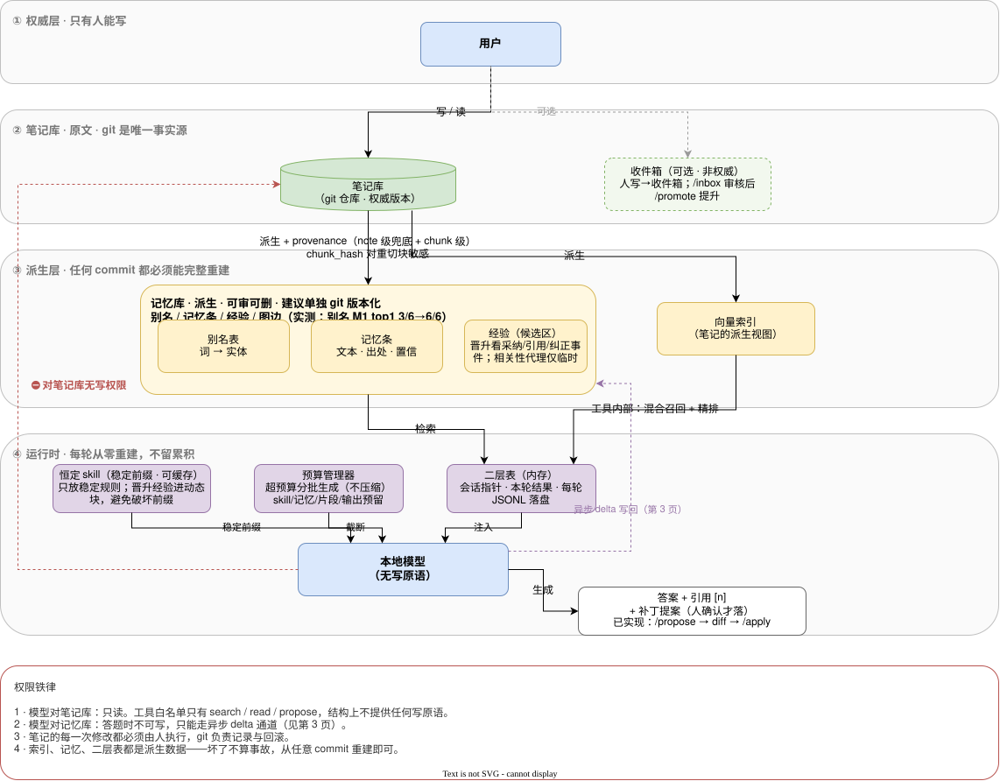

<div align="center">

<h1>Collaplex Recall</h1>

<p><strong>本地优先的笔记记忆库</strong></p>

<p>Markdown 入库 · 向量 + BM25 混合召回 · 记忆提炼 · 带引用问答</p>

<p>
  
  
  
  
  
  
</p>

</div>

> 笔记是人写的权威原文，由 git 管理。模型对笔记库**只读**；所有写入都以 diff 提案的形式交给人执行。

Collaplex Recall 是一个跑在本机的个人笔记检索与问答系统。它把 Markdown 笔记切成块，
用向量和 BM25 双路召回，再让本地聊天模型基于召回原文作答，并强制标注 `[n]` 引用。
回答之后，后台会把值得记住的事实、别名、经验提炼进独立的记忆库，下一轮提问时再带回来。

---

## 目录

[特性](#特性) · [TUI](#tui) · [快速开始](#快速开始) · [核心架构](#核心架构) ·
[检索](#检索) · [三遍链路](#三遍链路) · [记忆与经验](#记忆与经验) ·
[常用命令](#常用命令) · [数据模型](#数据模型) · [评测](#评测) ·
[运维](#运维) · [已知限制](#已知限制)

## 特性

| 能力 | 说明 |
|---|---|
| **混合检索** | pgvector 余弦召回 + 自建 BM25；两段式重排，默认 α=0.05 |
| **三遍链路** | 判题改写 → 模型选材 / 程序装原文 → 生成 + 引用校验 |
| **记忆库** | 异步提炼记忆、别名、经验候选，带 provenance、软删除和去重 |
| **记忆图** | 共引加强、半衰期衰减、LTD、一跳扩展 |
| **写入边界** | 模型只出 unified diff 提案，`/apply` 是唯一写笔记文件的入口 |
| **TUI** | 仿 Python REPL，斜杠命令菜单、实时 KV/上下文状态、Markdown 渲染 |
| **运维** | 组件自检、看门狗、四段式日志、`/quit` 按顺序关闭模型服务 |

## TUI

```text
collaplex-recall 0.1.0 (2026-11-19) [Rust + PostgreSQL 18/pgvector] on linux
embedding: Qwen3-Embedding-0.6B | chat: local-chat
Type "/" to browse commands, "/help" for help, "/quit" to exit.
======================================================================

>>> 等响度补偿是多少 dB？

等响度补偿在 200 Hz 施加 -8 dB 的搁架滤波器 [1]。

来源
[1] 音频链路.md › 音频链路 › 等响度

[完成 3.9s] | [69 token]  KV [███▌        ] 695/4,096 | 上下文 [████        ] 460/2,000
```

- 输入 `/` 自动列出全部命令，继续输入按名称过滤；`↑↓` 选择，`Tab` / `Enter` 补全
- 生成过程不显示思考、不流式吐字；结束后整段做 Markdown 渲染
- 状态行常驻：生成 KV 用量 + 本轮检索上下文预算

## 快速开始

### 安装

```bash
git clone https://github.com/Collaplex/Collaplex-Recall.git
cd Collaplex-Recall
./scripts/install.sh          # 默认装到 ~/.local，PREFIX=/path 可改
```

安装后的布局：

```text
~/.local/bin/recall                    # 命令入口（带默认环境的 wrapper）
~/.local/bin/collaplex-recall          # 软链
~/.local/lib/collaplex-recall/         # release 二进制 + 模型启动脚本
~/.local/share/collaplex-recall/logs/  # 会话、提炼、看门狗日志
```

### 初始化、导入、问答

```bash
recall init
recall supervise        # 缺组件就拉起，等健康后返回
recall ingest ~/你的笔记目录
recall tui
```

`recall tui` 启动时也会自检本机组件，缺 PostgreSQL、嵌入或聊天服务就自动拉起；
`NOTE_SELFCHECK=off` 可关闭。也可以显式管理：

```bash
recall supervise                  # 一次性自检
recall supervise --watch --rerank # 常驻看门狗，带精排
```

没有嵌入模型也能跑：`NOTE_EMBED=hash` 走离线哈希向量，检索质量差但全链路可通。

## 核心架构



四层职责：

- **权威层**：只有人写，`git` 是唯一事实源；模型对笔记库没有写权限
- **派生层**：chunk、向量、BM25 倒排、记忆、别名、经验、图边，全部可重建或可审计
- **运行时**：每轮从零重建上下文；稳定 skill 前缀保证 prefix cache 可命中；
  会话指针只活在本轮；预算超了就分批，不压缩、不丢原文
- **写回**：答案带 `[n]` 引用；补丁只能走 `propose → diff → 人执行 /apply`

完整设计图：

| 页面 | 渲染 | 源文件 |
|---|---|---|
| 1-架构总览 | [`架构总览.svg`](docs/diagrams/架构总览.svg) | [`笔记软件原理.drawio`](docs/diagrams/笔记软件原理.drawio) |
| 2-提问链路 | [`提问链路.svg`](docs/diagrams/提问链路.svg) | 同上 |
| 3-整理链路 | [`整理链路.svg`](docs/diagrams/整理链路.svg) | 同上 |

实现与设计图的逐项对照见 [`docs/设计对照-2026-11-18.md`](docs/设计对照-2026-11-18.md)。

## 检索

两路召回：

- **向量**：pgvector `<=>` 余弦距离，Qwen3-Embedding-0.6B（1024 维）走 llama.cpp 的 `/v1/embeddings`
- **字面**：真 BM25（k1=1.2，b=0.75），倒排表在 `chunk_terms`；中文按双字建词项，
  逐词项取倒排后在 Rust 里打分，避免 SQL 大表 join 退化

融合默认是**两段式**：向量先召回候选，候选集内用 BM25 重排，不引入新文档：

```text
score = cosine + α · bm25_norm      # α 默认 0.05
```

`rrf` 并行融合保留为可选，但实测会稀释向量。α=0 等价纯向量，命令行 `--alpha` 可临时覆盖，
`recall tune --apply` 会把校准值写进 `settings.alpha`。

> 嵌入前缀参与 `model_id`。ingest 和检索必须使用同一个查询前缀，否则会出现“向量 0 候选”；
> CLI/TUI 会提示库里实际存在哪些模型。

## 三遍链路

1. **判题改写**：聊天模型输出严格 JSON（`query` / `intent` / `entities`），
   3 秒超时；失败就退回原问题 + 确定性指代展开。
2. **选材 + 预算**：模型只挑候选编号；程序按相关性顺序装**全部**选中原文，
   按 token 预算分批，**不压缩、不概括、不截断**。
3. **生成**：稳定 skill 前缀 + RAG 原文 + 问题 → 带 `[n]` 引用的回答。

之后还会做引用校验：编号必须在来源范围内，并让聊天模型判断引用是否支撑结论；
`NOTE_VERIFY_STRICT=on` 时校验不通过直接拒答。

## 记忆与经验

回答结束后，TUI 在后台异步提炼，不阻塞下一轮输入：

- **记忆条**：≤3 条，绑定来源 chunk；改笔记后自动降级为 `stale`，不自动删除
- **别名**：≤5 条，拒绝定义式、互相包含、实体不在来源里的映射；检索前确定性展开
- **经验**：候选先不晋升，等 `/adopt`、`/cite`、`/reject` 的反馈累计到阈值
- **图边**：同轮共引加强，读取时按半衰期衰减，失败/删除时 LTD
- **审计**：产物先写 pending delta，再由提交点校验合并；崩溃可用 `recall delta merge` 补跑

记忆的 provenance 精确到 chunk；`recall memory check`、`reextract`、`reextract --model`
分别用于检查、确定性重绑和模型重提炼。

## 常用命令

| 命令 | 作用 |
|---|---|
| `recall init` | 建库建表（幂等） |
| `recall ingest <目录>` | 导入或增量更新 Markdown |
| `recall search <查询>` | 只检索，看两路名次与分数 |
| `recall tui` | 交互式问答 |
| `recall stats` | 笔记 / 块 / 向量概况 |
| `recall supervise [--watch] [--rerank]` | 组件自检或看门狗 |
| `recall memory …` | 记忆条增删查、provenance 检查、重提炼 |
| `recall alias …` | 别名增删查 |
| `recall experience …` | 经验候选、晋升、拒绝 |
| `recall tune` | 用反馈重放检索排序，网格搜索 α |

TUI 内还支持：

| 命令 | 作用 |
|---|---|
| `/search` `/stats` | 检索、索引概况 |
| `/memory` `/alias` `/experience` | 记忆、别名、经验 |
| `/note` `/inbox` `/promote` | 收件箱 |
| `/propose` `/proposals` `/apply` `/discard` | 补丁提案与执行 |
| `/adopt` `/reject` `/cite` `/feedback` | 反馈埋点 |
| `/last` `/why` | 重看上一轮检索、解释排序 |
| `/quit` | 退出并按 精排 → 聊天 → 嵌入 关闭本机服务 |

## 数据模型

| 表 | 内容 |
|---|---|
| `notes` | 路径、标题、内容哈希、git commit |
| `chunks` | 块正文、标题路径、块哈希、词数 |
| `chunk_terms` | BM25 倒排：chunk_id + term + tf |
| `embeddings` | chunk_id + model + dim + pgvector |
| `memories` | 事实、provenance、pinned、status |
| `aliases` | 词 → 实体，唯一约束 |
| `experiences` | 候选 / 晋升的经验规则 |
| `memory_edges` | 记忆图边、权重、更新时间 |
| `feedback` | 采纳 / 纠正 / 引用 / 删记忆 |
| `proposals` | diff 提案、base_hash、状态 |
| `memory_deltas` | pending / applied 提炼审计 |

索引是**派生数据**：清空后重新 `ingest` 即可重建；记忆、经验、反馈和提案只存在数据库里，需要单独备份。

## 评测

### DuRetrieval（公开集，2000 查询，k=10）

| 模式 | recall@10 | hit@10 | MRR | nDCG@10 |
|---|---:|---:|---:|---:|
| 纯向量 Qwen3-Embedding-0.6B | 0.8475 | 0.9680 | 0.8971 | 0.8273 |
| 纯 BM25（双字词项） | 0.5806 | 0.8605 | 0.7184 | 0.5706 |
| RRF 等权（历史） | 0.7546 | 0.9460 | 0.8475 | 0.7349 |
| **两段式 α=0.05（默认）** | **0.8510** | **0.9690** | **0.8972** | **0.8297** |

### 真实笔记冒烟（knowledge-garden，959 篇 / 2788 块）

| 模式 | recall@10 | MRR | nDCG@10 |
|---|---:|---:|---:|
| **两段式 hybrid** | **0.98** | **0.927** | **0.941** |
| 纯向量 | 0.98 | 0.917 | 0.933 |
| 纯 BM25 | 0.94 | 0.795 | 0.831 |

真实个人笔记上字面召回明显有用，和 DuRetrieval 的结论相反。
这批 50 题是模型从金标片段合成的，数字偏乐观，不等同于人工标注验收。

### 交叉编码器精排

`bge-reranker-v2-m3` 默认关闭，因为收益是语料相关的：

| 语料 | 基线 hybrid | + rerank |
|---|---|---|
| 真实笔记 50 题 | 0.98 / 0.927 / 0.941 | 0.98 / 0.878 / 0.903 |
| DuRetrieval 200 题 | 0.859 / 0.901 / 0.835 | 0.859 / 0.906 / 0.854 |

格式为 recall@10 / MRR / nDCG@10。单查询精排约 0.4 s。

## 运维

```bash
recall supervise --watch --interval 30 --rerank
```

- 自检顺序：PostgreSQL → 嵌入 → 聊天 → 可选精排
- 缺失组件用 `setsid` 拉起，等待 `/health` 就绪
- 日志为四段式 `[时间] [级别] [动作] [结果]`：
  `~/.local/share/collaplex-recall/logs/supervisor.log`
- 服务日志：同目录下 `{embed,chat,rerank}-server.log`
- 升级后重跑 `./scripts/install.sh`

## 已知限制

- 真实笔记还缺**人工标注**评测集；当前是合成题 + 人工修正
- git 同步只在 TUI 启动时比对 HEAD，没有持续 watcher
- 笔记删除不会同步清理索引（当前只增改）
- 反馈自动调参尚未定论；经验晋升也没有吃反馈
- 经验复核仍是命令式，没有可视化面板；图边按之前决定不做图形化

完整安装、全部环境变量、故障排查和数据维护见 **[`docs/使用文档.md`](docs/使用文档.md)**；
实现与设计图的逐项对照见 **[`docs/设计对照-2026-11-18.md`](docs/设计对照-2026-11-18.md)**。

## License

Apache License 2.0，见 [`LICENSE`](LICENSE) 与 [`NOTICE`](NOTICE)。

覆盖仓库内的代码、文档和 `docs/diagrams/` 下的架构图；模型权重、第三方评测语料不在本仓库，
分别适用它们自己的许可证。
